## open source contributions

**visit my [personal website](https://dsanch.com/projects) to see my projects**

### pull requests

<!--CONTRIB BEGIN-->
#### [ghostty](https://github.com/ghostty-org/ghostty) 62626
- [cli/list-fonts: add an interactive font picker to +list-fonts](https://github.com/ghostty-org/ghostty/pull/14693) 
- [cli/list-themes: copy config lines and show results on save screen](https://github.com/ghostty-org/ghostty/pull/14606) 
- [macos: opacity-toggle setting persists between tabs in a window and to a newly created window](https://github.com/ghostty-org/ghostty/pull/11583) 
- [cli/list-themes: add ctrl-d/u paging](https://github.com/ghostty-org/ghostty/pull/14607) 
- [cli/list-themes: fix keypad page down binding](https://github.com/ghostty-org/ghostty/pull/14605) 
#### [Maccy](https://github.com/p0deje/Maccy) 22081
- [Show image size in preview](https://github.com/p0deje/Maccy/pull/1589) 
#### [tinymist](https://github.com/Myriad-Dreamin/tinymist) 3612
- [feat: add CLI page-title support for preview HTML title](https://github.com/Myriad-Dreamin/tinymist/pull/2445) 
#### [friendly-snippets](https://github.com/rafamadriz/friendly-snippets) 2781
- [added semicolons at the end of statements from "puts" to "reallocarray" down the file chronologically](https://github.com/rafamadriz/friendly-snippets/pull/568) 
#### [IBC](https://github.com/IbcAlpha/IBC) 1607
- [Update userguide.md](https://github.com/IbcAlpha/IBC/pull/303) 
#### [charm-in-the-wild](https://github.com/charm-and-friends/charm-in-the-wild) 310
- [add niimtui to charm-in-the-wild list](https://github.com/charm-and-friends/charm-in-the-wild/pull/131) 
#### [gtab](https://github.com/Franvy/gtab) 158
- [feat(tui): preview split layouts in tabs pane](https://github.com/Franvy/gtab/pull/5) 
- [fix: improve filtering ux](https://github.com/Franvy/gtab/pull/4) 
<!--CONTRIB END-->

This README is updated daily by [a python script running in GitHub Actions](https://github.com/davidsanchez222/davidsanchez222/blob/master/update.py)
